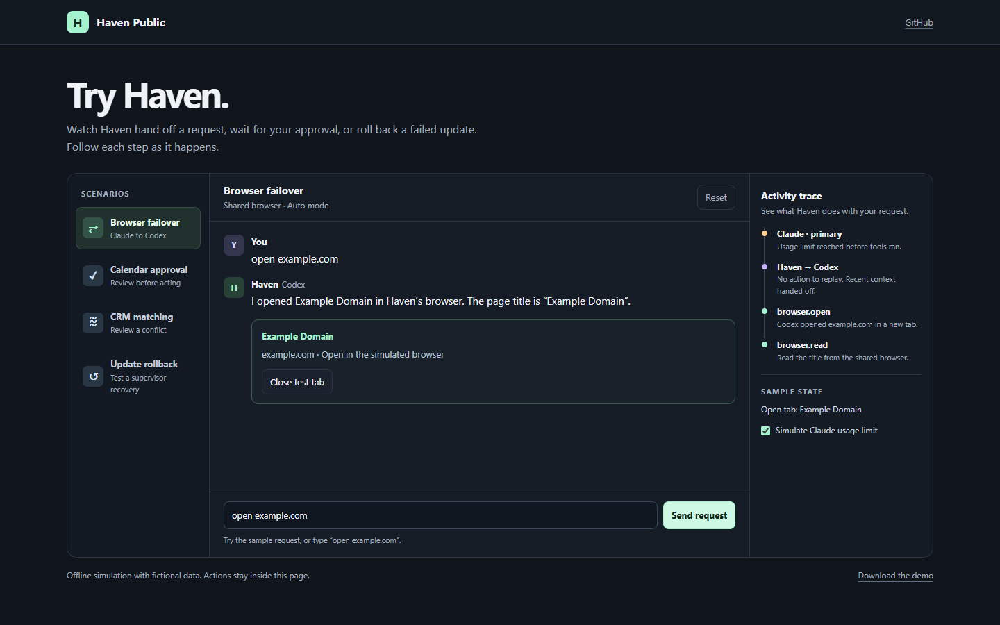

# Haven

**A Discord assistant that can switch AI backends mid-conversation and ask before it acts.**

I built Haven to do everyday work on my Windows computer from Discord. When Claude hits a usage limit, Codex can pick up the request and drive the same browser. When an action needs my approval, Haven shows me exactly what it plans to do.

**[Try the live demo](https://bluezip231.github.io/Haven-Public/haven-demo.html)** · [Download the offline demo](https://github.com/Bluezip231/Haven-Public/releases/latest/download/haven-demo.zip)

Press **Send request** and follow the tool calls in the activity trace. To run it offline, unzip the download and open `haven-demo.html`. The demo uses fictional data and simulated actions.

## Try it in a minute

- **Browser failover** lets you toggle Claude’s usage limit and watch who opens the same browser tab.
- **Calendar approval** lets you name an event and see the sample calendar change only after you approve it.
- **CRM matching** lets you resolve conflicting email addresses and rerun the comparison.
- **Update rollback** lets you simulate a successful startup or a timeout and see which version stays online.

## What I built

| Feature | How it works |
| --- | --- |
| **AI failover** | Haven can route a request to Codex when Claude is unavailable and carry recent conversation context across the switch. It checks for actions that may already have run before deciding whether to retry. |
| **Shared browser** | Both AI backends use the same Playwright-controlled Chrome profile. They can open pages, read and interact with them, and return screenshots in Discord. |
| **Approval cards** | Before certain actions, such as sending email or changing a calendar event, Haven shows me what it plans to do. The action runs only after I approve it. |
| **CRM and automations** | A SQLite-backed dashboard manages contacts, reviews likely duplicates, and compares records from two lists. A scheduler runs jobs such as reconciliation and health reports. |
| **Supervised updates** | Haven can prepare code changes in an isolated Git worktree and test them there. A separate supervisor starts the updated bot, checks that it connects to Discord, and can roll back a failed startup. |

## A bug I tracked down

Codex used to say it couldn’t control the browser even though Haven had already registered the browser tools. Restarting Haven brought up a new bot process, but Codex resumed a thread with older instructions. The updated session handling starts a fresh AI session after a build or instruction change and carries over recent exchanges.

I verified the fix from Discord. Codex opened a test page, posted a screenshot, and closed the test tab. I then restarted Haven from Discord and repeated the browser check. I also denied a test calendar approval and confirmed the create action was never run.

## Built with

Python, discord.py, Claude Agent SDK, Codex SDK, Playwright, SQLite, Starlette, Docker, and Git.

This repository contains the portfolio case study and offline demo. The full assistant and its source live in a private repository.

If the demo gives you an idea for your own AI assistant, consider starring the repo.
